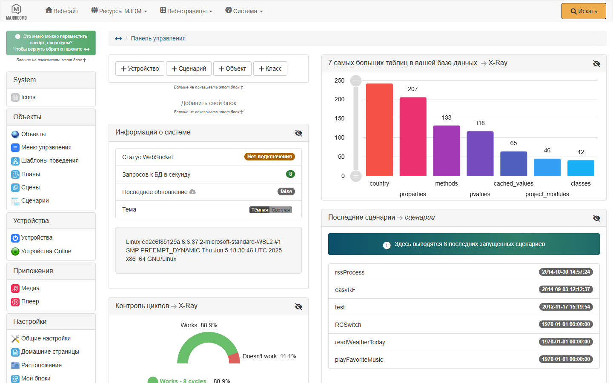
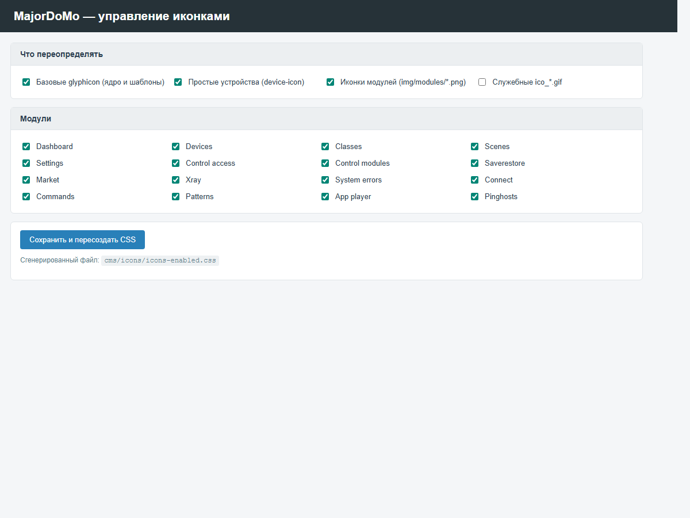

# Локальные иконки для MajorDoMo

Пакет дополняет локальный слой **Font Awesome Free 7.3.1** для MajorDoMo. Ни один ресурс не загружается из интернета — решение подходит для автономной установки (DMZ, 100% Privacy & Local Execution, обсуждение в `sergejey/majordomo#1321`, `#1322`, `#1342`, `#1426`).

Актуальное ядро уже содержит `css/fontawesome-compat.css` и локальные шрифты Font Awesome. Модуль синхронизирован с этой версией и добавляет только дополнительные группы иконок (устройства, модули, админка).



## Что входит

| Файл | Назначение |
|---|---|
| `css/fontawesome-compat.css` | Копия исправленного слоя ядра: только сопоставленные `glyphicon-*` заменяются Font Awesome, остальные сохраняют штатный шрифт |
| `css/fontawesome-devices.css` | Цветные шрифтовые иконки «Простых устройств» (`device-icon.temperature`, `.humidity`, `.light`, …) |
| `css/fontawesome-module-icons.css` | База для замены `img/modules/*.png` |
| `css/fontawesome-admin-icons.css` | Замена служебных `ico_*.gif` |
| `3rdparty/fontawesome/` | Локальные CSS и четыре woff2-шрифта |
| `modules/icons/`, `templates/icons/` | Модуль настроек со страницей `?action=icons` |
| `languages/icons_*.php` | Словари en/ru/ua; `uk.php` — алиас `ua.php` |
| `template-icons.patch` | Примеры добавления недостающих пиктограмм в шаблоны |
| `dist/icons.tgz` | Готовый архив для Маркета дополнений |

## Установка

### Через Маркет дополнений

1. Скопируйте `dist/icons.tgz` в `cms/saverestore/` вашей установки MajorDoMo.
2. Откройте **Панель управления → Маркет → Установить из файла** и выберите архив.
3. `install.php` зарегистрирует модуль `icons`, создаст `cms/icons/icons-enabled.css` и добавит его подключение в `templates/common_header.html`.
4. Откройте `?action=icons` и включите нужные группы.

### Вручную

1. Распакуйте `dist/icons.tgz` в корень MajorDoMo (внутри архива нет родительской папки).
2. Выполните `php install.php` из распакованной папки или повторите шаги регистрации вручную из [INSTALL.ru.md](docs/INSTALL.ru.md).
3. Перезагрузите страницу панели управления.

## Настройка



На странице `?action=icons` отмечаются группы:

- **Базовые glyphicon** — подменяет шрифт/glyph-коды, разметка остаётся прежней;
- **Простые устройства** — цветные иконки по типу устройства;
- **Иконки модулей** — можно выбрать конкретные модули из списка;
- **Служебные ico_*.gif** — замена на глифы в админке.

После сохранения создаётся `cms/icons/icons-enabled.css`, который содержит только включённые группы и выбранные модули. Для групп «модули», «устройства» и «админка» на контейнер нужно повесить класс `fa-module-icons`, `fa-devices` или `fa-admin-icons`.

Подробнее: [CONFIG.ru.md](docs/CONFIG.ru.md), [ICONS.ru.md](docs/ICONS.ru.md), [TROUBLESHOOTING.ru.md](docs/TROUBLESHOOTING.ru.md).

## Совместимость с ядром

- `css/fontawesome-compat.css` в пакете идентичен исправленной версии ядра (коммит `8e220311`): 65 сопоставленных классов, `content` с `!important`, никакого общего правила на голый `.glyphicon`. Несопоставленные глифы остаются штатными.
- Если ядро уже подключает `css/fontawesome-compat.css` в `common_header.html`, сгенерированный `icons-enabled.css` **не** добавляет повторный `@import` — нет двойного запроса и нет риска перекрыть исправленную версию.
- Группа «Простые устройства» использует актуальные классы шаблонов (`light-sensor`, `power-sensor`, `current-sensor`, `voltage-sensor`, `group_state` и др.). Иконки с собственным `background-image` в `style` не перекрываются, поэтому partial-обновление виджета (`mjApplyWidgetHTML`) работает без артефактов.
- Цвета берутся из токенов ядра `--mj-color-*`, `--mj-widget-icon-fg/on/off` с fallback-значениями — иконки остаются читаемыми в тёмной теме.
- `template-icons.patch` больше не нужен: все пять правок разметки уже есть в ядре. Файл оставлен только для совместимости со старыми инструкциями.

## Проверка

```bash
php tests/icons_config_test.php
php tests/package_test.php
```

Тесты проверяют генерацию CSS, фильтрацию модулей, наличие всех словарей и состав архива. Совместимость: PHP 7.3–8.2.

## Удаление

Удаление через **Модули → icons → Удалить** вызывает `icons::uninstall()`: строка подключения удаляется из `common_header.html`, удаляются `cms/icons/config.json`, сгенерированный CSS и список файлов пакета. Файлы CSS/шрифтов, скопированные в корень, удаляются вручную — так сторонние шаблоны не сломаются после удаления модуля.

## Лицензия

Код пакета — MIT. Font Awesome Free 7.3.1: иконки — CC BY 4.0, шрифты — SIL OFL 1.1, код — MIT. Полные тексты и атрибуция в [LICENSE.md](LICENSE.md).
